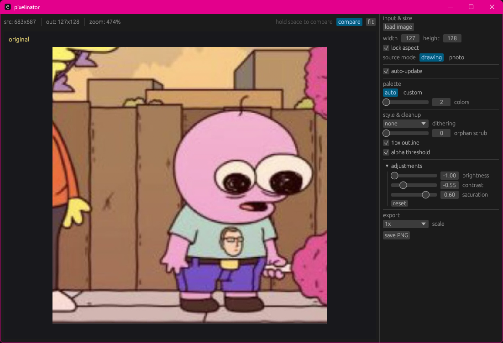
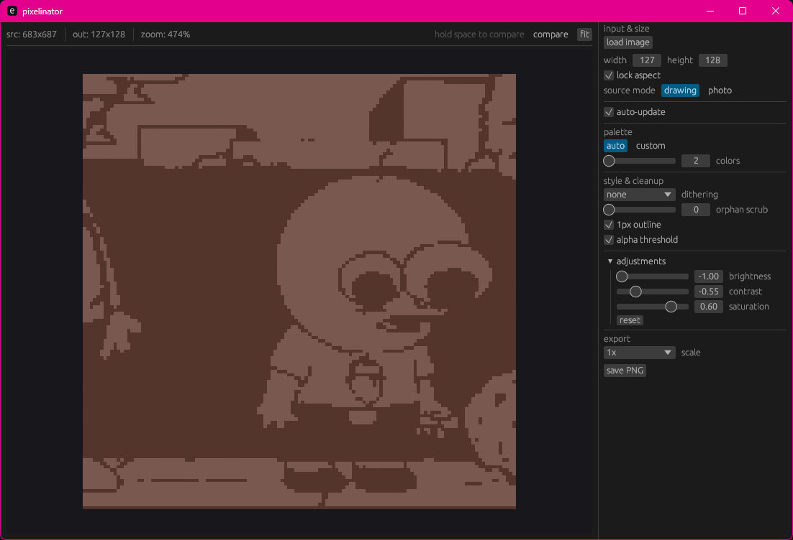
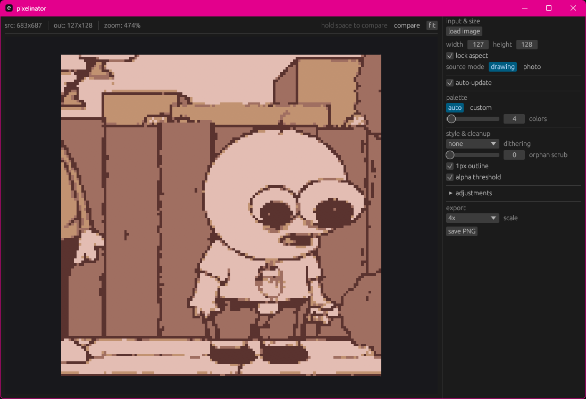

# pixelinator

lightweight, 100% offline, zero-AI native desktop pixel art converter built in rust with `eframe` / `egui`.

## screenshots







## features

- **input & sizing**: load images via file dialog or drag-and-drop, set target width/height with aspect-ratio lock, and switch between `drawing` and `photo` modes
- **edge-aware downscaling**: modal color-bucket downscaling avoids muddy box-blur edges
- **perceptual palettes**: extract 2–64 colors in oklab space (`auto`) or load custom `.hex`, `.pal`, and `.gpl` palettes
- **dithering**: `none`, `bayer 2x2`, `bayer 4x4`, and `floyd-steinberg` in oklab space
- **cleanup & outlines**: `orphan scrub` (`0`–`3`), optional 1px adaptive outline, and strict alpha thresholding
- **adjustments**: brightness, contrast, and saturation controls
- **responsive preview**: 80ms debounced background worker with 4-stage pipeline caching, nearest-neighbor viewport, scroll-to-zoom, drag-to-pan, and hold `space` to compare with the original
- **export**: nearest-neighbor integer upscaling (`1x`, `2x`, `4x`, `8x`, or custom) and `PNG` export

## build & run

```sh
cargo run --release
```

or build the release binary:

```sh
cargo build --release
```

## license

[MIT](LICENSE)
